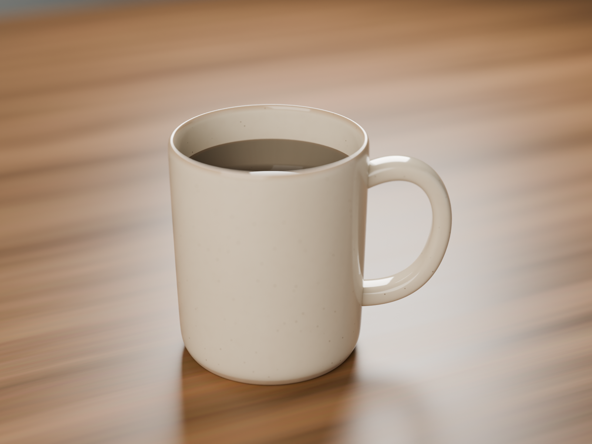

# Realistic coffee mug — done

**What I assumed:** "coffee mug" with no other details, so I made a classic 11 oz straight-sided stoneware mug, 82 mm wide and 95 mm tall, full of black coffee, on an oiled-wood tabletop and shot as a soft studio product photo.

## What was built (collection `Model_CoffeeMug`)
- **Mug_Body**: one revolved profile with a real 4 mm wall, a thicker base, a rolled rim, and a recessed foot ring with a hollow underside. Subdivision Surface softens it into ceramic-like rounded edges.
- **Mug_Handle**: a rounded oval cross-section swept along a C-shaped Bézier path. It tapers slightly in the middle and its ends sink into the wall. It's parented to the body.
- **Mug_Coffee**: a liquid surface with a slight meniscus where it meets the wall, sitting about 15 mm below the rim.
- **Environment**: a bevelled wooden tabletop and a soft grey wall behind it, out of focus.

## Materials (all procedural, no image textures)
- **MAT_Ceramic_SpeckledGlaze**: cream stoneware glaze with subtle colour variation and sparse iron speckles (Voronoi masked by noise). The glaze thins to toasty brown on the rim, and the foot ring is bare, rough clay. Gloss roughness varies between 0.06 and 0.16 like faint smudges, with a light orange-peel bump on the glaze and grain on the clay.
- **MAT_Coffee_Black**: near-black coffee that shifts to a brown crema tint at the edge, with very fine ripples on the surface.
- **MAT_Wood_OiledOak**: warped, stretched grain built from noise, with pore streaks and varying roughness.
- **MAT_Wall_PaintedPlaster**: matte, with mottled colour.

## Lighting, camera, render
- Three area lights aimed at the mug: a warm key at upper left, a cool fill from the right, and a rim light from behind. The world is a dim neutral grey.
- CAM_Hero: 70 mm lens, f/4, focused on the mug, with a slight high three-quarter angle.
- Cycles on the GPU (OptiX), 512 samples with denoising, indirect light clamped at 10. AgX view transform with the Medium High Contrast look, 1600×1200.

## Files
- `coffee_mug.blend` (confirmed on disk by Blender)
- `final_render.png` (1600×1200, confirmed on disk)

## Notes and rough spots
- The coffee surface looks a little greyish-brown rather than inky black, because it reflects the brightly lit inside of the mug. I lowered its specular level to 0.25 (physically about 0.5) to keep it reading as coffee. That's an artistic cheat, not a measured value.
- The rim colour change and the speckles are subtle at this distance. They show up in close-ups.
- The handle's end caps are n-gons, but they're hidden inside the mug wall, so they don't affect the render. The QA audit found no other issues: no floating or sinking, every object has a material, and the scale is real-world.
- Possible next steps: steam, a few drips or a coffee ring on the table, an HDRI for richer reflections, or a different glaze colour if you had one in mind.
